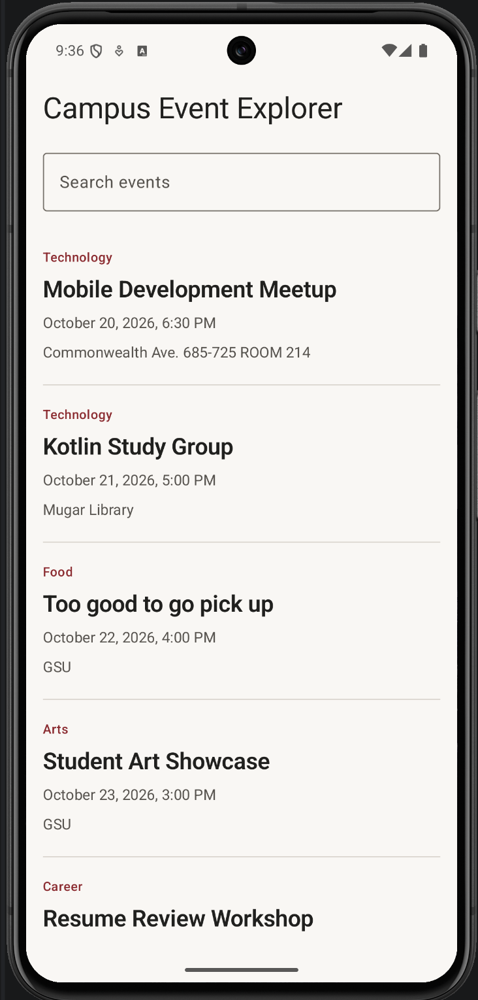
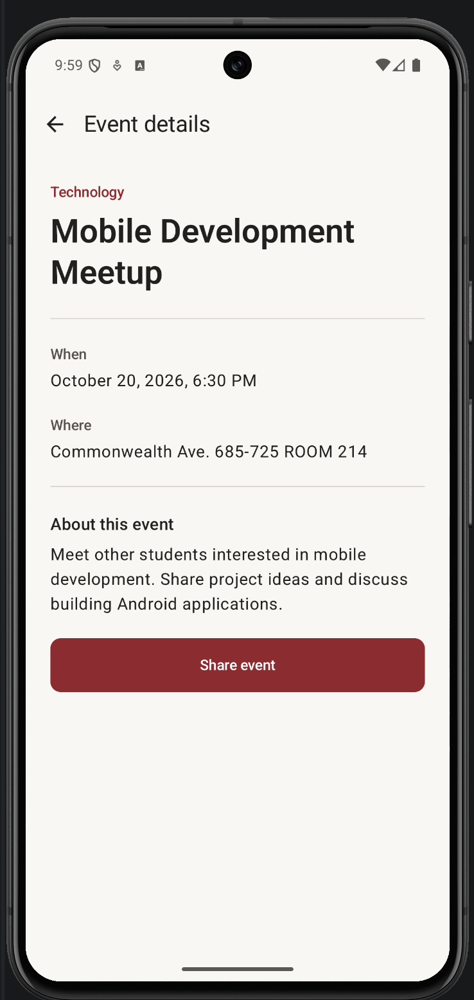

# Campus Event Explorer

An Android app for browsing eight sample campus events, searching by title or category, reading event details, and sharing an event through the Android Sharesheet. The events are demonstration data, not a live campus schedule.

## Run

Open the project in Android Studio, install Android SDK 37, sync Gradle, and run the `app` configuration on an emulator or device using API 24 or later.

## Design decisions

1. **Why pass an ID?** `EventDetail` contains only the stable event ID. The destination uses `toRoute()` and looks up that ID in `CampusEventData.events`. This keeps navigation arguments small and avoids copying the complete event. An unknown ID displays “Event unavailable” with a return button.

2. **Who owns search state?** `CampusEventApp` owns `searchQuery`. `EventListScreen` receives its value and reports edits through `onQueryChange`. Filtered results are calculated from the query rather than stored as a second mutable list.

3. **Why rememberSaveable?** It restores the search text after rotation. Keeping this state above the navigation host also preserves the query while the detail destination is open.

4. **What happens to the back stack?** Selecting an event adds its detail destination above the list. System Back and app-bar Up remove that detail entry and reveal the existing list.

5. **How does the UI navigate?** Screen composables invoke callbacks such as `onEventSelected` and `onBack`. `CampusEventApp` connects those callbacks to the navigation controller.

6. **Why is sharing implicit?** `ACTION_SEND` specifies plain-text content without naming a receiving app. `Intent.createChooser()` lets Android display available share targets. The text includes the title, time, and location.

## Screenshots

| Event list | Event details |
| --- | --- |
|  |  |

Additional screenshots: [Search](docs/screenshots/event-search.png), [Share](docs/screenshots/event-share.png), [Invalid ID test](docs/screenshots/invalid-event-test.png).

## Collaboration and AI disclosure

This assignment was completed by me independently. I had Codex write the README and organize the git commits for me, but I answered all the questions in the README myself—no AI was used for that.